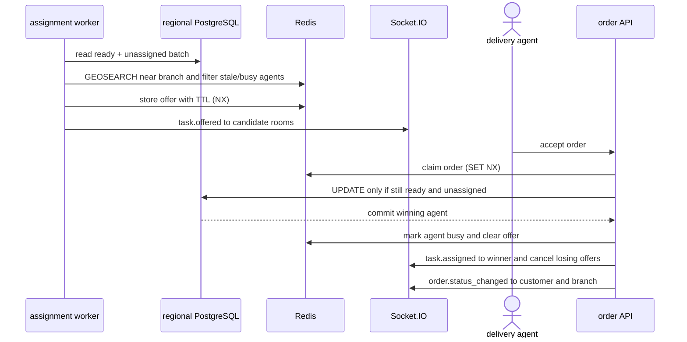
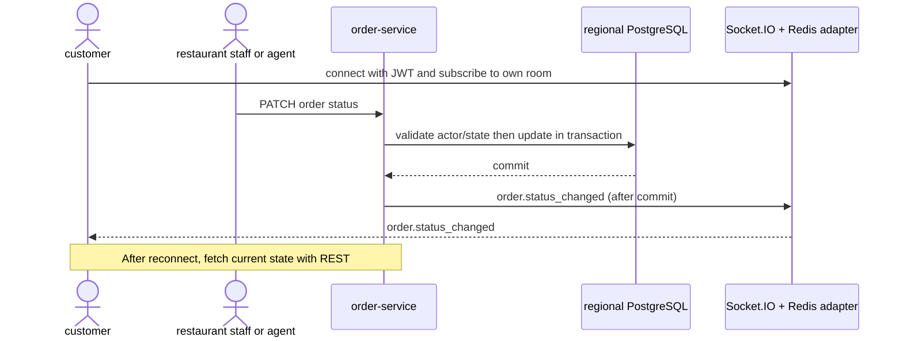

# Order service — system design

Order-service owns order, payment, delivery and settlement state. PostgreSQL is the
authority for orders and money; Redis holds short-lived coordination and cache data.

## Delivery assignment

An order becomes eligible when it reaches `ready`. A worker ticks per region, reads the
oldest ready/unassigned orders, and asks Redis for the nearest agents whose presence is
fresh and who are not busy.

Redis is useful for geo-search and fast contention handling, but it is not the final
authority: the conditional database update guarantees only one agent can own a still-ready
order. Rejections or expired offers are retried on a later tick; after the configured
attempt limit the worker alerts admins and leaves the order ready.

## Customer status and WebSocket

The client authenticates its Socket.IO handshake with the core-issued JWT. The server
derives allowed rooms from that identity and checks every subscription; customers can join
their own `customer:<id>` room, not an arbitrary order room. Socket.IO is mounted at `/ws`.

The Redis Socket.IO adapter fans events across API instances. WebSocket delivery is
low-latency but not a durable log; `GET /api/orders/:publicId` is the recovery path.

## Authorization

- Core issues JWTs containing the system role and restaurant/branch scope. Customers can
  read their own orders; agents can act only on their assigned order; restaurant users
  are scoped to their restaurant and branch; admins have an explicit bypass.
- Fine-grained `resource:action` checks use permissions fetched from core and cached in
  the order process. They guard branch order-list reads, finance, payments and assignment
  routes.
- Restaurant status updates currently use membership/branch checks plus the order state
  machine; that route does not yet check a fine-grained permission for each transition.
- The permission cache has an event invalidation handler, but core currently does not
  publish `rbac.permissions_changed`; permission changes can remain cached until expiry.

## Regional sharding and time partitioning

These are two different levels: `X-Region` (or the `region` query fallback) selects a
regional PostgreSQL database; inside each database, the `orders` table is range-partitioned
monthly by `created_at`. Only `orders` is partitioned. A default partition catches inserts
outside the pre-created range, while `scripts/create-partitions.ts` maintains the next
12 months and should be scheduled monthly.

Region co-locates the customer, restaurant and delivery agent for the normal read/write
path. The trade-off is that global admin reads may fan out across databases. PostgreSQL
also requires the partition key in parent uniqueness/foreign-key constraints: the order
primary key includes `created_at`, and `order_items` relies on service-level integrity
rather than a foreign key to the partitioned table.

Order items, address text/location, branch coordinates and prices are snapshotted at
placement so later catalog or address edits do not rewrite order history. Money is stored
as integer minor units with a currency.

## Messaging, cache and settlement

- Branch/product data use Redis read-through caches (one-hour TTL); `core.events` refreshes
  or invalidates them. The branch order list has a short cache that is invalidated on writes.
  Redis also stores agent presence, offers, busy flags and Socket.IO pub/sub; none of these
  replace the order database.
- The inbound `core.events` consumer uses manual acknowledgements, Redis `SET NX` event-ID
  dedupe (24 hours) and a dead-letter queue. Replaying a failed message requires clearing
  its dedupe key.
- For emitted events, the domain change and outbound `order.events` row commit together. A
  worker drains each regional outbox with `FOR UPDATE SKIP LOCKED` and broker confirmations.
  Analytics currently aggregates `order.placed` events; see its [consumer design](https://github.com/marwanoosama/crave-analytics-service).
- On `delivered`, one PostgreSQL transaction records any COD collection, commission and
  fee adjustments, updates the restaurant balance, inserts the agent earning, changes the
  order status and writes the outbox event. Redis and WebSocket effects happen after commit.
- The generic `Idempotency-Key` middleware caches responses in Redis for 24 hours; it is
  not itself a transactional lock. Payment webhooks and ledger rows also use database
  uniqueness for durable duplicate protection.
